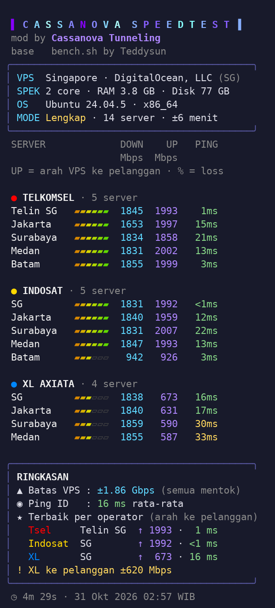

# Bench-Mod

Speedtest VPS ke server **operator kartu seluler Indonesia** (Telkomsel, Indosat, XL) dan **Singapura**, dengan tampilan rapi yang aman untuk terminal HP.

<p align="center"></p>

<p align="center"><sub>Hasil mode <b>Lengkap</b> di VPS DigitalOcean Singapura (2 core).</sub></p>

## Cara pakai

Bisa dijalankan di **VPS mana pun**, tidak perlu memasang SC apa pun.

**Pilih mode dari menu:**
```bash
bash <(curl -sSL https://raw.githubusercontent.com/amiercassanova-21/Bench-Mod/main/bench.sh)
```

**Atau dengan curl lalu bash:**
```bash
curl -sS -H 'Cache-Control: no-cache, no-store' https://raw.githubusercontent.com/amiercassanova-21/Bench-Mod/main/bench.sh | bash
```

**Langsung ke mode tertentu** (tanpa menu):
```bash
curl -sS -H 'Cache-Control: no-cache, no-store' https://raw.githubusercontent.com/amiercassanova-21/Bench-Mod/main/bench.sh | bash -s lengkap
```
Ganti `lengkap` dengan salah satu mode di bawah.

## Mode

| Mode | Isi tes | Waktu |
|---|---|---|
| `cepat` | Server terdekat + 1 server tiap operator (Jakarta, atau SG bila VPS di Singapura) | ±2 menit |
| `id` | Semua kota operator di Indonesia | ±5 menit |
| `sg` | Server Singapura tiap operator | ±2 menit |
| `lengkap` | VPS di Indonesia: semua kota Indonesia. VPS di luar Indonesia: semua server, negara VPS dites lebih dulu | ±5-6 menit |
| `<id server>` | Satu server Speedtest pilihan, contoh `bash -s 71028` | ±30 detik |

## Daftar server

| Operator | Kota |
|---|---|
| ● Telkomsel | Jakarta, Surabaya, Medan, Batam, Telin SG |
| ● Indosat | Jakarta, Surabaya, Medan, Batam, SG |
| ● XL Axiata | Jakarta, Surabaya, Medan, SG |

Hanya operator kartu seluler. Smartfren sudah bergabung ke XL, dan layanan WiFi rumahan tidak dimasukkan.

Daftar server ada di [`speedtest-servers.txt`](speedtest-servers.txt) dan diambil ulang setiap tes. Kalau ada server yang mati, cukup ganti ID-nya di file itu, tanpa mengubah `bench.sh`. Server yang tidak menjawab ditandai `! server tidak aktif · dilewati`.

Format tiap baris: `OPERATOR|Kota|ID atau SG|ID server Ookla`

## Cara membaca hasil

| Kolom | Arti |
|---|---|
| **DOWN** | Data dari server operator **ke VPS** (arah pelanggan mengirim/upload) |
| **UP** | Data dari VPS **ke jaringan operator**. Arah ini yang dipakai pelanggan saat streaming, download, dan buka web, jadi **paling penting untuk VPS tunneling** |
| **PING** | Hijau di bawah 30 ms, kuning di bawah 80 ms, merah di atasnya |
| `2%` | Packet loss, hanya tampil bila ada |

Bar memakai skala tetap dari kolom **UP**: 100 / 250 / 500 / 1000 / 1500 / 1800 Mbps.

**Ringkasan**
- **Batas VPS**: muncul bila download hampir semua server mentok di angka yang sama. Artinya angka itu batas port VPS, bukan kecepatan operator.
- **Ping ID**: rata-rata ping ke server di Indonesia.
- **Terbaik per operator**: server dengan UP terbesar (selisih di bawah 10% dianggap sama), lalu ping terendah. Pelanggan memakai kartu yang berbeda-beda, jadi tiap operator punya pilihan terbaiknya sendiri.
- **Operator lemah**: ditandai bila rata-rata UP-nya jauh di bawah operator lain.
- **Server gagal**: server yang tidak menjawab saat tes.

Angka ini kecepatan **VPS ke jaringan operator**. Kecepatan di HP pelanggan tetap tergantung sinyal dan jaringan seluler mereka.

## Catatan
- Memakai **Speedtest CLI resmi Ookla 1.2.0**. File diunduh sekali ke `~/.bench-mod/` dan dicek SHA-256 sebelum dipakai.
- Mendukung `x86_64` dan `aarch64` (ARM). Diuji di Ubuntu dan Debian.
- Selama tes, bandwidth VPS terpakai penuh. Pengguna lain di VPS itu bisa melambat sebentar.
- Info lokasi VPS diambil dari ipwho.is (cadangan: ip-api.com).

## Kredit
- **Base:** [bench.sh](https://github.com/teddysun/across) by **Teddysun**
- **Mod:** **Cassanova Tunneling**
- Speedtest CLI © Ookla. Pemakaian tunduk pada lisensi Ookla.
